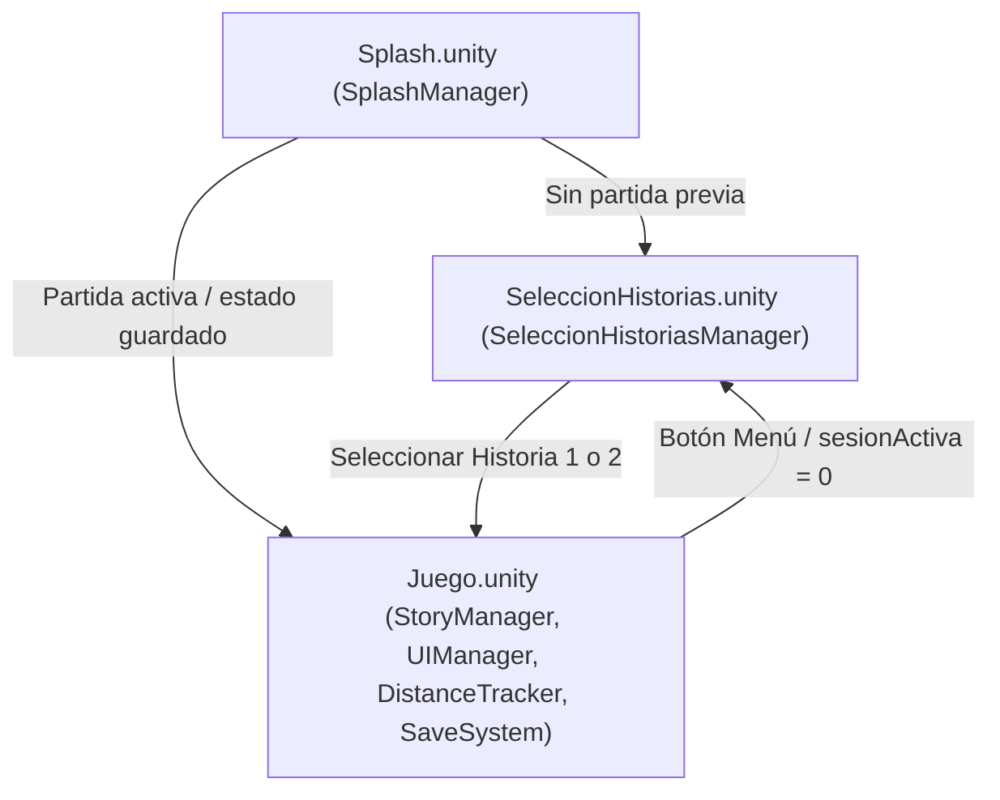
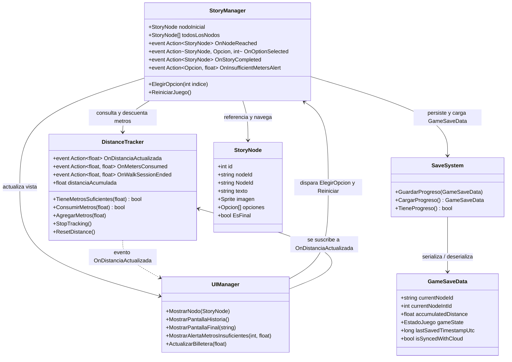

# 🧠 Graphify: Tesis Project — Knowledge Graph

## 🗺️ Flujo de Escenas

---

## 🏛️ Componentes y Arquitectura de Scripts (`Assets/Scripts/`)

### 1. `StoryManager` (`StoryManager.cs`)
- **Rol:** Orquestador principal del ciclo de vida narrativo en la escena `Juego`.
- **Dependencias Directas:** `UIManager`, `DistanceTracker`, `SaveSystem` (vía `GetComponent`).
- **Estado Interno:** `nodoActual` (StoryNode), `nodoInicial` (StoryNode), `todosLosNodos` (StoryNode[]), `historiaTerminada` (bool), `inicializado` (bool).
- **Eventos de Telemetría & Desacoplo:**
  - `public event Action<StoryNode> OnNodeReached;` — Notifica la llegada a un nodo narrativo.
  - `public event Action<StoryNode, Opcion, int> OnOptionSelected;` — Emite la decisión narrativa elegida por el usuario con costo y destino.
  - `public event Action<StoryNode> OnStoryCompleted;` — Disparado cuando se alcanza un nodo final.
  - `public event Action<Opcion, float> OnInsufficientMetersAlert;` — Mide fricción cuando el usuario intenta elegir sin saldo de metros suficiente.
- **Métodos Clave:**
  - `ElegirOpcion(int indice)`: Emite `OnOptionSelected`, valida saldo en `DistanceTracker`. Si alcanza, descuenta y avanza; si no, dispara `OnInsufficientMetersAlert` y alerta UI.
  - `AvanzarANodo(StoryNode siguienteNodo)`: Actualiza nodo actual, evalúa si es final (`nodoActual.EsFinal` -> `OnStoryCompleted`), actualiza UI y persiste estado con `SaveSystem`.
  - `NuevaPartida()`, `CargarPartida()`, `ReiniciarJuego()`.
  - `OnApplicationPause(bool)` y `OnApplicationQuit()`: Auto-guardado en ciclo de vida móvil.

### 2. `DistanceTracker` (`DistanceTracker.cs`)
- **Rol:** Tracker de distancia y gestor de "billetera de metros".
- **Dependencias:** `UnityEngine.LocationService` (Unity Input/Android GPS), `PlayerPrefs`.
- **Eventos de Telemetría & UI:**
  - `public event Action<float> OnDistanciaActualizada;` — Emitido cada vez que se acumulan, consumen o resetean metros.
  - `public event Action<float, float> OnMetersConsumed;` — (metrosConsumidos, saldoRestante) para telemetría transaccional.
  - `public event Action<float, float> OnWalkSessionEnded;` — (distanciaTotalSesion, duracionSegundos) al detener el tracking.
- **Lógica de GPS / Tracking:**
  - Corrutina `StartTracking()`: Petición de permiso `Permission.FineLocation`, inicio de servicio (`1m, 0.5f`), registro de `sessionStartTime`.
  - Warmup: Descarte de las primeras 10 muestras (`warmupSamples = 10`) para estabilizar precisión.
  - Filtro Haversine: Calcula metros entre coordenadas descartando jitter (`minDistance = 0.5f`, `maxDistance = 30f`, `maxAccuracy = 30f`).
- **Lógica de Billetera:**
  - `TieneMetrosSuficientes(float metros)`: Booleano de validación.
  - `ConsumirMetros(float metros)`: Deducción transaccional de saldo, emisión de `OnMetersConsumed` y guardado.
  - `AgregarMetros(float metros)`: Simulación / inyección de metros para pruebas.
  - `ResetDistance()`: Limpia metros acumulados.

### 3. `UIManager` (`UIManager.cs`)
- **Rol:** Vista desacoplada y gestor de interacción gráfica.
- **Dependencias Directas:** `StoryManager`, `SaveSystem`, `DistanceTracker` (vía `GetComponent`).
- **Sub-vistas / Paneles:**
  - `pantallaHistoria` (GameObject): Diálogo (`textoNodo`), opciones (`textoOpcion1`, `textoOpcion2`, `botonOpcion1`, `botonOpcion2`).
  - `pantallaFinal` (GameObject): `textoFinal`, `botonReiniciar`.
  - `panelAlertaMetros` (GameObject): Cartel modal de metros insuficientes con `botonCerrarAlerta`.
  - `billetera`: `textoBilleteraMetros`, `botonSimularMetros` (+50m), `botonReset`, `botonMenu`.
- **Manejo de Ciclo de Vida UI:** Corrutinas `MostrarPantallaHistoriaCoroutine()` y `MostrarPantallaFinalCoroutine()` con frames de espera (`yield return null`) para transiciones limpias.

### 4. `SaveSystem` (`SaveSystem.cs`) & `GameSaveData`
- **Rol:** Persistencia estructurada, DTO serializable y soporte para sincronización offline/cloud.
- **DTO `GameSaveData`:**
  - `string currentNodeId`: ID string para Firestore y Analytics.
  - `int currentNodeIntId`: ID numérico para compatibilidad legacy.
  - `float accumulatedDistance`: Metros totales en billetera.
  - `EstadoJuego gameState`: Estado actual (`Historia = 0`, `Final = 1`).
  - `int selectedStoryId`: Historia activa.
  - `long lastSavedTimestampUtc`: Timestamp Unix UTC para resolución de conflictos offline/cloud.
  - `bool isSyncedWithCloud`: Bandera de sincronización con Firestore.
- **Métodos:**
  - `GuardarProgreso(GameSaveData)` / sobrecarga legacy `GuardarProgreso(int, float, EstadoJuego)`.
  - `CargarProgreso()`: Deserializa JSON con migración automática desde claves PlayerPrefs sueltas.
  - `TieneProgreso()`, `BorrarProgreso(bool conservarMetros)`.

### 5. `StoryNode` (`StoryNode.cs`)
- **Rol:** `ScriptableObject` definitorio de estructura de grafo narrativo con soporte de telemetría.
- **Campos:**
  - `int id`: ID numérico legacy.
  - `string nodeId`: String ID alfanumérico para Firestore/Analytics.
  - `string NodeId =>`: Propiedad getter con fallback inteligente (`nodeId` -> `name` -> `id.ToString()`).
  - `string texto`: Contenido narrativo del nodo.
  - `Sprite imagen`: Ilustración asociada.
  - `Opcion[] opciones`: Opciones de ramificación.
- **Propiedad:** `EsFinal => opciones == null || opciones.Length == 0`.
- **Estructura `Opcion`:**
  - `string opcionId`: String ID de la opción.
  - `string OpcionId =>`: Getter con fallback (`opcionId` -> `texto`).
  - `string texto`: Etiqueta descriptiva.
  - `int costo`: Costo en metros para seleccionar la opción.
  - `StoryNode siguienteNodo`: Referencia directa al siguiente nodo en el árbol.

### 6. `SplashManager` (`SplashManager.cs`)
- **Rol:** Controlador de puerta de entrada en escena `Splash`.
- **Lógica:** Si existe `estadoJuego` y `sesionActiva == 1`, muestra "Continuar" hacia `Juego`; caso contrario muestra "Comenzar" hacia `SeleccionHistorias`.

### 7. `SeleccionHistoriasManager` (`SeleccionHistoriasManager.cs`)
- **Rol:** Selector de trama en escena `SeleccionHistorias`.
- **Lógica:** Establece `PlayerPrefs("historiaSeleccionada")` y transiciona a `Juego`.

---

## 🔗 Grafo de Llamadas y Acoplamiento

---

## 📚 Datos de Historia Actual (`Assets/Stories/Historia1`)
- **Total de Nodos:** 14 ScriptableObjects (`Nodo_01.asset` a `Nodo_14.asset`).
- **Nodos Ramificados:** Nodos intermedios con 1 a 2 opciones de costo en metros (`opciones[i].costo`).
- **Nodos Finales:** Hojas sin opciones que activan `pantallaFinal`.

---

## ⚡ Puntos de Atención & Optimizaciones Clave
1. **Zero-GC en Loop de Tracking:** `DistanceTracker.cs:129` tiene interpolaciones de strings en log recurrente (`$"Dist: {distance:F2} | Acc: {accuracy:F2}"`). Debe silenciarse o pasar a profiling condicional.
2. **Consistencia de Keys de PlayerPrefs:** Centralizar constantes string de guardado entre `SaveSystem`, `DistanceTracker` y `SplashManager` para evitar desacoples silenciosos.
3. **Mocks de GPS para Pruebas (Fase 1):** Utilizar simulador interno (botón `botonSimularMetros` o mock provider) sin depender de hardware físico ni APIs nativas.
4. **Desacoplo de Audio:** Preparado para integrar `AudioManager` que escuche `StoryManager.OnNodeReached` según directiva de arquitectura.
